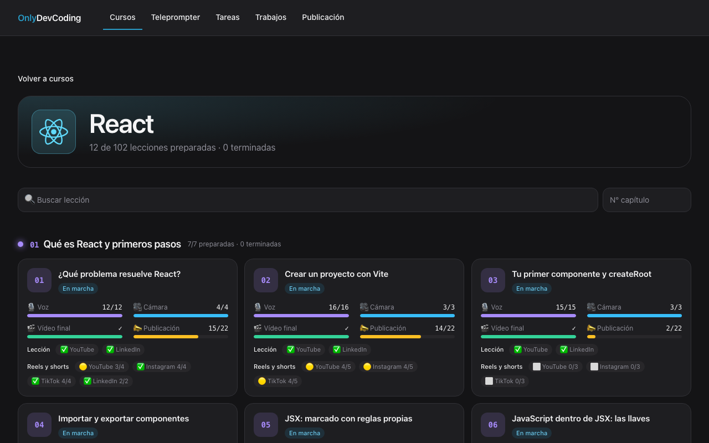
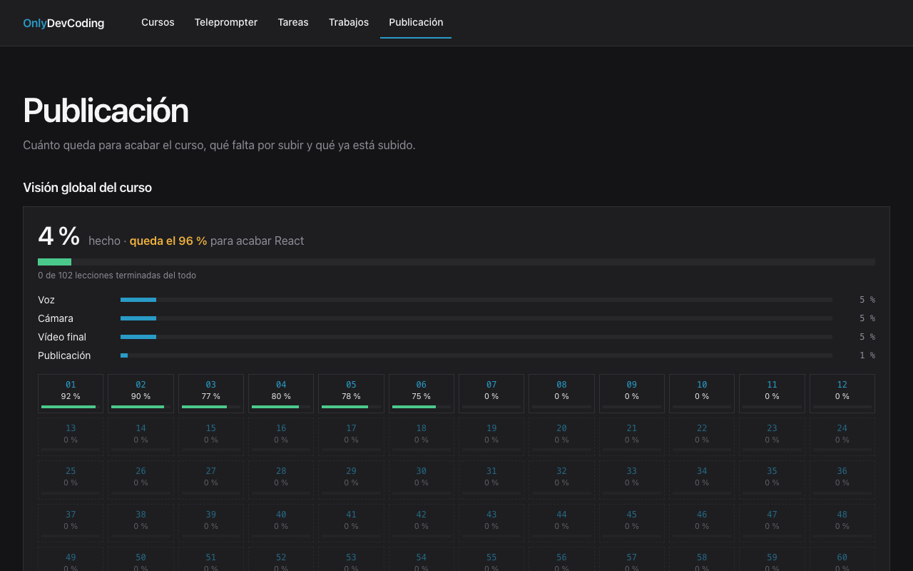
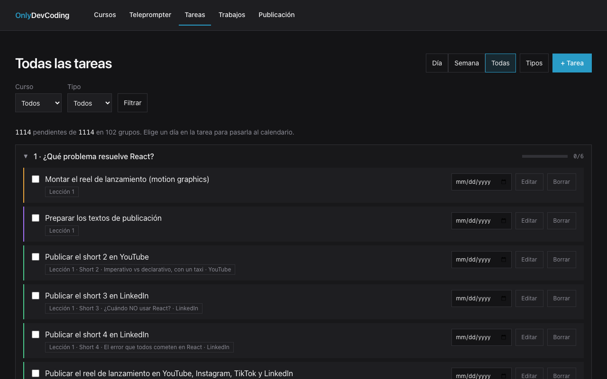
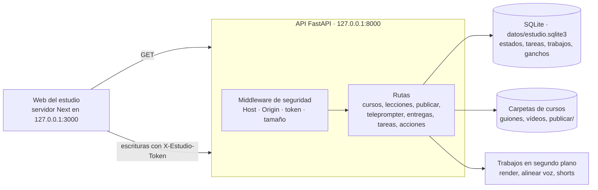
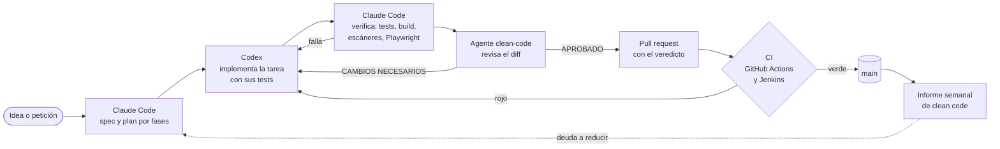
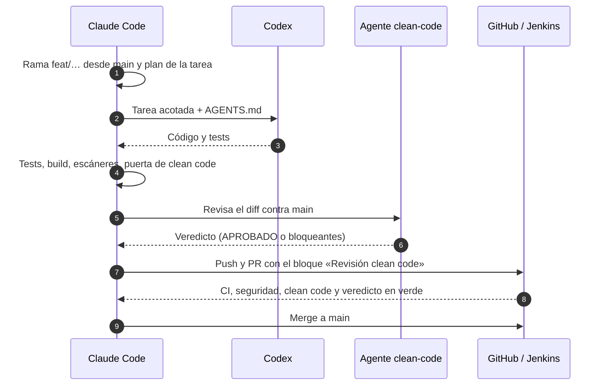
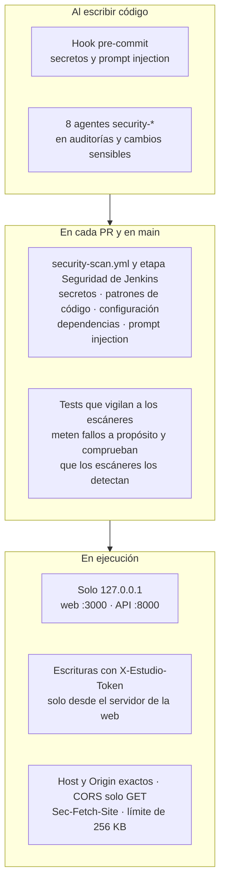
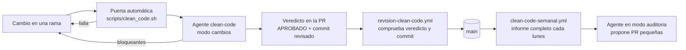

# API local del estudio de OnlyDevCoding

API FastAPI local que lee y prepara el material del estudio de OnlyDevCoding: cursos,
lecciones, guiones, grabaciones, montaje, publicación en redes, ganchos de los reels, tareas y
trabajos en segundo plano. La usa la web del estudio
([onlydevcoding-estudio-web](https://github.com/pedroleni/onlydevcoding-estudio-web)) y solo
escucha en la interfaz local.

## Capturas

La API no publica interfaz propia (la documentación interactiva está desactivada): esto es lo
que sirve, visto desde la web.

| | |
|---|---|
|  |  |
| `GET /api/cursos/{curso}/lecciones` y `/temario`: estado de producción de cada lección. | `GET /api/cursos/{curso}/lecciones/{numero}/publicacion` de cada lección, sumadas en la web: qué está subido y qué falta. |



`GET /api/tareas/sin-fecha`: la lista total de tareas del curso, enlazadas a su lección.

## Arquitectura de la aplicación



- **Lectura**: las rutas `GET` leen las carpetas de los cursos y la base SQLite.
- **Escritura**: solo con `X-Estudio-Token` y siempre en archivos previstos de cada lección,
  que se reemplazan de forma atómica.
- **Base de datos**: SQLite con migraciones versionadas (`PRAGMA user_version`) y copia de
  seguridad automática antes de cada migración.
- **Trabajos**: las acciones largas se lanzan en segundo plano, sin solaparse en la misma
  lección, y se pueden seguir y cancelar.

## Cómo se desarrolla

El código lo escriben agentes de IA, pero nada llega a `main` sin pasar por las mismas
puertas: tests, seguridad, clean code y CI. Cada herramienta tiene un papel fijo.

| Quién | Qué hace | Qué no hace |
|---|---|---|
| **Claude Code** | Diseña (spec y plan por fases en `docs/specs` y `docs/plans`), reparte el trabajo, verifica por su cuenta (tests, build, escáneres, Playwright a varios anchos), pasa el agente de clean code, hace los commits, abre las PR y las integra cuando la CI está en verde. | No da por buena la palabra de otro agente: todo se vuelve a comprobar. |
| **Codex** | Implementa una tarea acotada del plan con sus tests, siguiendo `AGENTS.md`. | No toca `.git` ni la red (su sandbox no lo permite) ni comprueba la interfaz en el navegador: eso lo hace Claude Code. Si se queda sin cuota, implementa Claude Code. |
| **Agente `clean-code`** | Revisa el diff de cada PR contra `docs/clean-code.md` y emite un veredicto; en modo `auditoria` revisa el repo entero. | No edita: informa. Se ejecuta con la suscripción de Claude Code, sin claves de API. |
| **Agentes `security-*`** | Ocho checklists de seguridad (`.claude/agents/security-*.md`) para auditorías y cambios sensibles. | Solo reportan hallazgos con más del 80 % de confianza. |
| **GitHub Actions y Jenkins** | Repiten todas las comprobaciones en limpio en cada PR y en `main`. | No integran nada por su cuenta. |



### Un cambio, paso a paso



## Seguridad

La aplicación es local y sin autenticación, así que la seguridad se basa en no exponerse y
en comprobar cada cambio antes de que llegue a `main`.



- **Hook `pre-commit`** (`bash scripts/security/install_hooks.sh`): bloquea secretos y
  texto de prompt injection antes de que entren en un commit.
- **Escáneres** en `scripts/security/`: secretos, patrones de código peligrosos,
  configuración (workflows con permisos mínimos y acciones fijadas por SHA), dependencias y
  prompt injection. Se ejecutan en local, en GitHub (`security-scan.yml`) y en Jenkins.
- **Tests que vigilan a los escáneres** (`scripts/security/test_*.sh`): si un escáner se
  rompiera, seguiría diciendo «todo bien» y nadie se daría cuenta. Estos tests copian el repo a
  una carpeta temporal, meten fallos a propósito (una ruta privada o un email inventados, una
  frase de prompt injection, un workflow con permisos de escritura o con `pull_request_target`…)
  y comprueban que cada escáner salta cuando debe y
  calla cuando el código está limpio, que revisa todos los archivos del repo y que el hook
  `pre-commit` mira exactamente lo que va a entrar en el commit. Se ejecutan junto a los
  escáneres en GitHub y en Jenkins.
- **Agentes de seguridad**: ocho dominios en `.claude/agents/security-*.md`, con los
  precedentes del proyecto en `security/security-review-instructions.md`. Las auditorías
  completas se guardan en `security/reviews/`.
- **Repositorio público**: nada de rutas absolutas, emails ni datos reales; los valores
  privados solo viven en `.env`, que está ignorado.

## Clean code

Las normas están en [`docs/clean-code.md`](docs/clean-code.md): las convenciones del repo,
las normas de cada tecnología con sus fuentes, los umbrales y la checklist del revisor.



1. **Puerta automática** (bloquea la PR): ruff con complejidad, ramas, parámetros, simplificaciones y argumentos sin usar; pylint para código duplicado; vulture para código muerto. Se ejecuta con `uv run --frozen bash scripts/clean_code.sh`.
2. **Revisión del agente** (bloquea la PR): el agente `clean-code` revisa el diff contra
   `main` y su bloque «Revisión clean code» va en la descripción. La CI comprueba que dice
   `Veredicto: APROBADO` y que es del último commit: si llegan más commits, se vuelve a pasar.
3. **Revisión completa periódica**: cada lunes `clean-code-semanal.yml` genera el informe
   completo (resumen de la ejecución y artefacto `informe-clean-code`); cuando se pide, el
   agente hace la auditoría del repo entero y propone PR pequeñas para reducir deuda.
4. **Deuda congelada**: las funciones que ya incumplían llevan `# noqa: … - deuda congelada` y ruff avisa de los `noqa` que sobran; el código nuevo no puede añadir excepciones.

## Integración continua

| Comprobación | GitHub Actions | Jenkins (`Jenkinsfile`) |
|---|---|---|
| Escáneres de seguridad y los tests que los vigilan | `security-scan.yml` | etapa *Seguridad* |
| Lint y tests | `ci.yml` · job `test` | etapas *Lint* y *Tests* |
| Puerta de clean code | `ci.yml` · job `clean-code` | etapa *Clean code* |
| Veredicto del agente en la PR | `revision-clean-code.yml` | — (Jenkins construye `main`) |
| Informe completo de clean code | `clean-code-semanal.yml` (lunes) | — |

Jenkins corre en local (Docker, `127.0.0.1:8090`) y replica la CI de GitHub con las mismas
versiones y los mismos comandos.

## Puesta en marcha

### Configuración

Copia el archivo de ejemplo, adapta las dos rutas a tus directorios locales y
genera un token de escritura con el comando indicado en el propio archivo:

```sh
cp .env.example .env
```

La web permitida se puede cambiar mediante `ORIGEN_WEB`; por defecto es
`http://127.0.0.1:3000`. La web y la API deben abrirse ambas mediante
`127.0.0.1` para pertenecer al mismo sitio, y la API rechaza las peticiones
que el navegador marque con `Sec-Fetch-Site: cross-site`: una web de otro sitio
no puede incrustar ni pedir los medios. Una página servida en `127.0.0.1` en otro
puerto sí es del mismo sitio; por eso no conviene tener otros servidores web
locales no confiables abiertos a la vez. No se usa `Cross-Origin-Resource-Policy:
same-site` porque Chromium bloquea con ella los medios entre
`127.0.0.1:3000` y `127.0.0.1:8000`.

Toda petición distinta de `GET`, `HEAD` u `OPTIONS` necesita que
`X-Estudio-Token` coincida con `ESTUDIO_TOKEN`. Sin token configurado, las
escrituras quedan desactivadas; el token debe tener al menos 32 caracteres.
Los WebSocket también exigen el token. Además, cada escritura debe declarar un
único `Content-Length` válido, no puede usar `Transfer-Encoding` ni superar
256 KB declarados o reales. CORS continúa permitiendo solo `GET`, para que el
token permanezca en el servidor de la web.

`BD_RUTA` define la base SQLite local y, por defecto, vale
`datos/estudio.sqlite3`. La API solo puede escribir los archivos de publicación
previstos dentro de cada lección; los reemplaza de forma atómica y conserva el
contenido original en `<archivo>.antes-de-editar` antes de la primera edición.

### Arranque

```sh
uv run uvicorn --factory estudio_api.app:crear_app_desde_entorno \
  --host 127.0.0.1 --port 8000
```

### Comprobaciones

```sh
uv run --frozen ruff check .
uv run --frozen pytest -q
uv run --frozen bash scripts/clean_code.sh
for s in scripts/security/scan_*.sh; do bash "$s"; done
```
